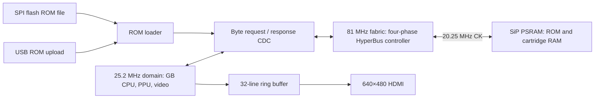

# FPGA Game Boy (DMG) on Tang Nano 9K

## Target and scope
- Board: Sipeed Tang Nano 9K, Gowin GW1NR-LV9QN88PC6/I5: 8640 LUT4, 6480 FF, 26 BSRAM blocks (18 Kbit each), 64 Mbit PSRAM, 32 Mbit SPI flash, HDMI connector.
- Goal: accurate Game Boy Color emulation with DMG compatibility. Game Boy Advance is out of scope.
- Game Boy Color: 32 KiB banked WRAM and 16 KiB banked VRAM are implemented. Full GBC emulation is not: the CPU still has DMG post-boot state, rendering is monochrome/bank 0, and speed switching, color attributes/palettes and HDMA remain unimplemented.
- Current build: DMG with file-backed ROM banking for MBC1/3/5. No physical cartridge interface. MBC3 RTC and broad mapper compatibility remain incomplete.

## Reproducing the build

The tested toolchain is [OSS CAD Suite 2026-11-04](https://github.com/YosysHQ/oss-cad-suite-build/releases/tag/2026-11-04), Darwin ARM64 on the development Mac. Extract it to `tools/oss-cad-suite`, or export `OSS_CAD_SUITE=/path/to/oss-cad-suite`. Run the suite's `activate` script once on macOS. Then, from this repository in Bash:

```bash
source env.sh
make bitstream
make flash
make rom ROM="/path/to/your/game.gb"
/usr/bin/python3 host/gbctl.py play
```

No ROMs or downloaded tools are bundled. For keyboard control, focus the pad window: arrows, Z/A, X/B, Enter/Start, Backspace/Select. Close that window before running `host/gbctl.py status`, `diagnose`, or `load`. `sim/psram/run.sh sweep` needs no ROM; `sim/run.sh /path/to/test.gb 600` runs a supplied ROM in the core simulation.

## Headless pixel readback

With no HDMI monitor attached, capture the running FPGA's 160×144 game image over the same USB cable:

```bash
/usr/bin/python3 host/gbctl.py screenshot build/screen.ppm
```

Close the keyboard pad first: the UART interface has one owner. This reads actual PPU pixels, not a host emulator or a simulated screenshot. It does not verify the HDMI serializer, electrical output, border overlays, or monitor compatibility. A screen takes approximately 2.5–3.1 seconds at 115200 baud; lines come from successive frames, so moving scenes can show rolling artifacts.

`V <y>` captures pixels 0–159 of scanline y without stopping the game. Reply: `V <y> <40 packed bytes> <sum8>`, with four 2-bit shades per byte, MSB first. `v <code>` reports reset/loading (1), LCD off (2), missing line within about 83 ms (3), or invalid line (4). The host checks line number/checksum and writes no image if capture fails. The 40-byte capture buffer is distributed RAM; UART FIFO backpressure prevents dropped reply bytes. `sim/capture/run.sh` exercises capture/TX/RX, packing, backpressure, interrupted lines and errors.


## PSRAM boot diagnostic
- Before loading a ROM, `rtl/psram_test.v` writes bytes `00 FF AA 55 12 34 81 6E` to addresses `000000..000003` and `200000..200003`, then reads all eight back. This checks adjacent byte lanes and one high address bit; it is not an exhaustive RAM test.
- On the first mismatch, ROM loading and CPU execution remain blocked. The five HDMI byte rows (green=1, MSB left) show expected byte, actual byte, `{done, passed, failing_address[21:16]}`, failing address bits 15:8, and bits 7:0. A completed failure has bit 7 set in row three.
- While the test is still pending, the five rows instead show controller flags, `{write, busy, address[21:16]}`, address bits 15:8, address bits 7:0, and elapsed fabric cycles. Controller flags are `{timeout, active, writing, configuring, first_byte_seen, read_complete, dq_drive, rwds_drive}`. A missing yellow bar is normal before the test passes and ROM loading begins.
- `/usr/bin/python3 host/gbctl.py diagnose` reads command `D`: nine bytes `{D, test_flags, controller_flags, address[21:16], address[15:8], address[7:0], expected, actual, elapsed_cycles}`. Test flags are `{done, pass, write, busy, ready, hang, request, logo_ok}`. Unlike the old client, USB UART initialization explicitly sets the FTDI baud/format/flow-control registers after reconnecting.
- After a pass, the rows return to ROM-header readback and bridge diagnostics. S1 reruns the test and reloads the ROM.
- The build fails on synthesis, routing, packing, or pipeline errors rather than accepting a pre-existing output file.
- `rtl/psram_controller.v` now uses four fabric phases per memory clock, with registered DQ/RWDS/CS/CK signals instead of ODDR/IDDR. The 81 MHz fabric produces 20.25 MHz CK and its complement; idle is CK=0, CK#=1.
- CR0=`0x9FEF`: 35-ohm drive, IL=3, fixed 2x latency. Register writes immediately follow the three CA clocks; memory writes start at zero-based clock 8. Reads take the first RWDS-high byte followed by its RWDS-low byte, not an arbitrary late burst sample.
- Missing read strobes release the physical bus before the 4 us maximum transaction duration and leave the controller busy; the bridge reports a timeout rather than returning fabricated data.
- `sim/psram/run.sh sweep` exercises the real controller, bridge and boot test against a pin-level HyperRAM model. It checks byte masks, all 22 address bits, ROM-bank/RAM-region boundaries, protocol timing, contention and the complete CDC round trip. All 15 tested delay combinations passed; maximum observed round trip was 833.322 ns versus an 833.333 ns DMG data deadline. That worst case reaches the two-pixel-clock setup boundary; it is not spare bandwidth for GBC double speed.
- The old DDR implementation reproduced `expected 00 / got 55` with a shortened modeled receive pipeline, despite correct memory contents. That demonstrates a receive-alignment defect under those conditions; the exact hardware pipeline has not been measured.
- Hardware isolation passed the eight-byte test at 27 MHz and 81 MHz fabric rates; direct and asynchronous-bridge probes each passed 20 reset/write/read repetitions at 81 MHz. The crystal-referenced probe measured 81.000 MHz memory fabric and approximately 25.207 MHz system clock (counter resolution approximately 0.105 MHz).
- Full-design placement affected correctness despite passing internal-clock timing. Receive FFs are now explicitly placed next to the GW1NR-9C die-0 DQ/RWDS pads, with CK and CS FFs also anchored near their pads. These board-specific BEL attributes preserve the four-phase schedule while reducing unmodeled pad-to-register and forwarded-clock routing skew.
- Sources: [Winbond protocol specification](https://cms.nacsemi.com/content/AuthDatasheets/Winbond/W955D8MBYA_85C_PKG_datasheet_A01-001_20190605.pdf), [zf3 controller and issues](https://github.com/zf3/psram-tang-nano-9k), [independent Nano9K hardware investigation](https://github.com/sabas0ba/hello_veryl/blob/de47429483ecaa137aac3ba68843993b30a37978/docs/psram.md). The new controller is implemented from the protocol specification; no unlicensed controller source was copied.

## Block diagram


## Clocking
- The GB core runs on one clock enable (`tick`) in the 25.2 MHz domain. It produces exactly 70224 dots per HDMI frame (800×525 = 420000 pixel clocks), so the GB runs at 60.00 Hz instead of 59.73 Hz (0.46% fast).
- `tick` spacing is 5–6 clocks. Every CPU input (bus data, IRQ lines, joypad) only changes on a tick edge. The CPU also registers `din` and the IRQ-pending vector one clock early. So all CPU-internal paths have at least 4 clocks to settle (multicycle by construction).
- The simulation testbench uses the same tick spacing as the hardware.
- Memory uses a separate 81 MHz fabric domain, constrained by `boards/tangnano9k/tangnano9k.sdc`. The pin model checks that requests return before the next DMG M-cycle. GBC double-speed bandwidth has not been established.

## Video without a frame buffer
- The 32-line ring buffer saves two BSRAM blocks compared with a full frame buffer. GB frame start is locked to HDMI position `TARGET = 380000` (line 475 of the previous HDMI frame).
- With 5.98 pixel clocks per dot, GB line *n* is fully written before HDMI line `24 + 3n` scans it. It is not overwritten by line *n+32* until HDMI has finished with it. Allowed phase window: −66142 … −28988 pixel clocks; −40000 is used.
- If the game turns the LCD off/on (frame phase changes), the tick generator pauses the core until HDMI reaches `TARGET` again. This takes at most one frame and is invisible because the first frame after LCD-on is blank on hardware too.
- Output: 3× integer scale, 480×432 centred in 640×480, DMG green palette.

## CPU (rtl/sm83.v)
- M-cycle accurate. Each M-cycle presents one bus operation, and opcode fetch overlaps the previous instruction's last cycle like the real SM83.
- Interrupt dispatch is 5 M-cycles. EI is delayed by one instruction. HALT wakes on IE&IF. The HALT bug is not emulated.
- IF/IE live inside the CPU.
- Reset release explicitly requests the opcode at `0x0100` before the first CPU M-cycle. Previously the first request was `0x0101`, so stale external-bus data could execute as the first opcode. The synthetic banking ROMs exposed this (`RST 38` from stale `FF`); fixing it also makes Blargg `instr_timing` complete instead of hanging.

## PPU (rtl/ppu.v)
- VRAM is a single BSRAM port shared with the CPU. The CPU is locked out in mode 3, as on hardware, so the PPU owns the port while drawing.
- OAM is 4×64×8 distributed LUT-RAM, so OAM scan reads a whole sprite entry per dot (40 entries in 80 dots, 10-per-line limit).
- Sprite pattern data is fetched at the start of mode 3 using the LCDC object size at fetch time (as hardware). Each sprite costs a 1-dot merge stall into an 8-pixel sprite FIFO (DMG X/OAM priority).
- BG/window: fetcher + 8-pixel shifter, SCX fine-scroll discard, window restarts the fetcher, internal window line counter.
- STAT interrupt uses a rising-edge OR of all sources (STAT blocking).

## Memory budget (BSRAM blocks)
| Use | Blocks |
|---|---|
| Cartridge ROM / RAM in PSRAM | 0 |
| WRAM 32 KiB (8 × 4 KiB banks) | 16 |
| VRAM 16 KiB (2 × 8 KiB banks) | 8 |
| Ring buffer 8192×2 | 1 |
| Headless scanline capture, HRAM and OAM (distributed RAM) | 0 |
| **Total** | **25 / 26** |

OAM DMA currently keeps DMG-style CPU bus lockout. WRAM source reads use the selected SVBK bank and the same echo mapping as CPU accesses. CGB-specific separate-bus arbitration and VRAM DMA sources are not yet implemented; E0/F0 DMA regression cases describe this core's current undocumented-source behavior, not verified CGB hardware behavior.

## GBC banking checks

The loader captures ROM header `0x143` bit 7 and passes it to the core as `cgb_mode`. In that mode, FF70 selects WRAM banks 1–7 (stored 0 aliases bank 1); C000–CFFF stays bank 0 and E000–FDFF mirrors the corresponding WRAM locations. FF4F selects CPU VRAM bank 0/1. In DMG mode these register writes are ignored and reads return FF. The PPU still fetches bank 0 regardless of CPU VBK.

`sim/banktest/run.sh` generates original DMG/CGB ROMs into `build/banktest`, then executes their assertions on the real CPU. They check bank isolation, boundary/echo accesses, zero-bank aliasing, DMA bank selection and mode-3 VRAM lockouts. Passing requires serial `Passed` plus a complete shade-1 frame while CPU VBK=1; failures emit a numbered check and shade 3. The generated ROMs deliberately contain no Nintendo logo, so their header-logo diagnostic being false is expected. They can also be uploaded with `gbctl.py load`.

## Synthesis and remaining budget

The default build uses `synth_gowin -noalu`. With banking and capture added, carry-chain mapping used 7,988 LUTs and failed legal placement. LUT arithmetic removed that placement bottleneck, but initially missed the 81 MHz constraint in the bridge's saturating diagnostic counter. Splitting that counter into independently enabled nibbles preserves its count and shortens the feedback path.

| Post-route metric | Earlier DMG build | Banked memory + USB capture |
|---|---:|---:|
| LUT4 | 7,426 / 8,640 | 7,430 / 8,640 |
| Flip-flops | 1,765 / 6,480 | 1,827 / 6,480 |
| BSRAM blocks | 9 / 26 | 25 / 26 |
| System-clock Fmax; required 25.2 MHz | 41.94 MHz | 27.42 MHz |
| Memory-clock Fmax; required 81 MHz | 156.94 MHz | 101.55 MHz |

These are single-route results, not a multi-seed optimum. Only one BSRAM block remains: widening the existing ring directly to 15-bit RGB will not fit alongside these memories. Full GBC needs a measured video-storage strategy, color rendering, correct CGB CPU state, HDMA and a proven double-speed memory deadline.

The capture logic is isolated in `rtl/line_capture.v` and taps the PPU passively. Keep it during development; remove it and its UART command path if GBC logic needs the space. The current mapped capture-module subtotal is 147 LUT1–LUT4 primitives, 7 wide muxes, 71 flip-flops and 6 RAM16SDP4 cells, plus shared UART/control logic. This is not a measured whole-design removal delta; placement/remapping can change the saving. It uses no BSRAM, so dropping capture does not solve the color-buffer memory limit.

## GBC accuracy targets

- Priorities: color-buffer/storage fit without reducing WRAM/VRAM; CGB CPU startup and color rendering; KEY1/double-speed and HDMA timing; audio, persistent saves, RTC and mapper coverage. Preserve DMG behavior at each step.
- Maximum-ROM gameplay target: the user-provided `../Densha de Go! 2 (J) [C][!].gbc`, 8,388,608 bytes, CGB flag C0, mapper 1B (MBC5+RAM+battery), 32 KiB cartridge RAM. SHA-256: `aaf85dc22020cc7103bfcacb0bdd54568d4b391a0483fd3e11f18cd35c9c05a6`, matching the [documented cartridge dump](https://gbhwdb.gekkio.fi/cartridges/CGB-B82J-0/gekkio-1.html). The ROM stays outside Git.
- Densha is not yet loadable: the current 22-bit cartridge path reserves the top 128 KiB of its 4 MiB window for save RAM, leaving 3.875 MiB for ROM. An 8 MiB ROM plus its 32 KiB save RAM requires a new backing-storage plan, not simply increasing the loader limit.
- ROM size is a capacity test, not proof of worst-case CPU/PPU timing. Use [cgb-acid2](https://github.com/mattcurrie/cgb-acid2) for color/priority/attribute output, applicable CGB [Mooneye](https://github.com/Gekkio/mooneye-test-suite) cases for hardware behavior, and [Mealybug Tearoom](https://github.com/mattcurrie/mealybug-tearoom-tests) for PPU timing, alongside commercial gameplay. These additional suites are planned, not claimed passing.
- Once the complete core and storage path are ready, test Densha through menus, gameplay, high ROM banks, audio and save/reload behavior. Also cover other mapper/RTC/graphics cases with games such as Pokémon Crystal, Zelda Oracle of Ages/Seasons and Shantae; do not optimize correctness around one title.


## Verification status
| Test | Result |
|---|---|
| Blargg cpu_instrs 01–11 | all pass |
| Blargg instr_timing | pass |
| dmg-acid2 | Pixel-exact in simulation and live USB capture: 0 / 23,040 shade mismatches |
| Earlier BRAM-ROM hardware: dmg-acid2 on HDMI | correct |
| Earlier BRAM-ROM hardware: 01-special loaded from SPI flash | Passed |
| Four-phase PSRAM pin-model regression | 15 delay combinations pass |
| Current full-design PSRAM eight-byte boot test | Pass; larger memory stress still needed |
| Batman loaded from SPI flash through PSRAM | Live FPGA pixels captured over USB without HDMI |
| ROM header self-check indicator | CE ED readback and logo_ok=1 on the connected board |
| Synthetic DMG/CGB banking ROMs | Simulation pass; both live board captures show the expected shade-1 result |
| USB scanline capture | Capture/TX/RX regression passes; live readback, invalid-line reply and LCD-off failure verified |
| Tetris USB joypad input | Sending Start changes the live title screen to the game-type menu |

## Not yet implemented
- APU (sound)
- GBC CPU post-boot state and speed switching, color PPU, and HDMA
- Boot ROM: the core starts at 0x0100 with post-boot register values
- Persistent cartridge-RAM saves and MBC3 RTC
