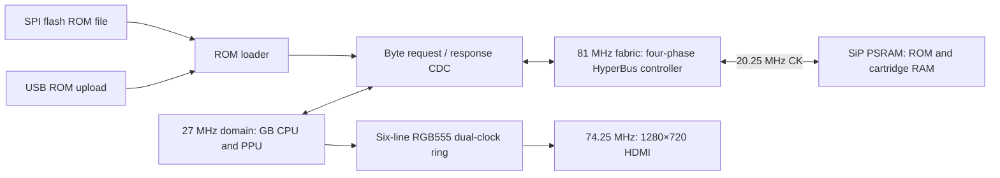

# FPGA Game Boy Color on Tang Nano 9K

## Target and scope
- Board: Sipeed Tang Nano 9K, Gowin GW1NR-LV9QN88PC6/I5: 8640 LUT4, 6480 FF, 26 BSRAM blocks (18 Kbit each), 64 Mbit PSRAM, 32 Mbit SPI flash, HDMI connector.
- Goal: accurate Game Boy Color emulation with DMG compatibility. Game Boy Advance is out of scope.
- Game Boy Color: 32 KiB banked WRAM, 16 KiB banked VRAM, CGB CPU startup registers and RGB555 rendering are implemented. KEY1/double-speed, HDMA and complete CGB bus/timing behavior remain unimplemented.
- File-backed ROM banking supports MBC1/3/5. There is no physical cartridge interface. Audio, persistent saves, MBC3 RTC and broad mapper compatibility remain incomplete.

**Checkpoint status:** `b183f65` is the last hardware-verified, flashed full-color build. The later memory work is an experimental checkpoint: the main design's memory fabric remains 81 MHz, but controller/bridge RTL has changed and has not been revalidated in the full FPGA design. Use `b183f65` for the known-good hardware build. No experimental memory probe was programmed onto the board.

## Reproducing the build

The tested toolchain is [OSS CAD Suite 2026-11-04](https://github.com/YosysHQ/oss-cad-suite-build/releases/tag/2026-11-04), Darwin ARM64 on the development Mac. Extract it to `tools/oss-cad-suite`, or export `OSS_CAD_SUITE=/path/to/oss-cad-suite`. Run the suite's `activate` script once on macOS. Then, from this repository in Bash:

```bash
source env.sh
make bitstream
make flash
make rom ROM="/path/to/your/game.gb"
/usr/bin/python3 host/gbctl.py play
```

No ROMs or downloaded tools are bundled. For keyboard control, focus the pad window: arrows, Z/A, X/B, Enter/Start, Backspace/Select. Close that window before running `host/gbctl.py status`, `diagnose`, or `load`. `sim/psram/run.sh sweep` needs no ROM; `sim/run.sh /path/to/test.gb 600` runs a supplied ROM in the core simulation.

## Headless pixel readback

With no HDMI monitor attached, capture the running FPGA's 160×144 game image over the same USB cable:

```bash
/usr/bin/python3 host/gbctl.py screenshot build/screen.ppm
/usr/bin/python3 host/gbctl.py screenshot-color build/color.ppm
/usr/bin/python3 host/gbctl.py scanout
```

Close the keyboard pad first: the UART interface has one owner. Screenshots read actual PPU pixels, not a host emulator or a simulated screenshot. They do not verify the dual-clock display buffer, HDMI serializer, electrical output or monitor compatibility. Lines come from successive frames, so moving scenes can show rolling artifacts.

`V <y>` returns `V <y> <40 packed bytes> <sum8>`: four 2-bit DMG shades per byte, MSB first. `W <y>` returns `W <y> <320 bytes> <sum8>`: 160 little-endian RGB555 values, bit 15 zero. The checksum sums the pixel bytes modulo 256. Lowercase `v` plus a code reports reset/loading (1), LCD off (2), missing line within about 78 ms (3), or invalid line (4). The host checks command, line number, payload and checksum, and writes no image if capture fails. Both formats share one synchronous 160×15-bit BSRAM. Read-ahead supports UART backpressure and a continuously ready sink. `sim/capture/run.sh` covers packing, backpressure, interrupted lines, errors and host image decoding. On the board, DMG/color captures took about 2.5/4.9 seconds respectively.

`F` returns `F <frame_counter> <signature_hi> <signature_lo>`. The signature starts at zero each video frame and folds every registered RGB output pixel inside the 800×720 game window: rotate the 16-bit accumulator left once, then XOR `{0, B[7:3], G[7:3], R[7:3]}`. A stable completed-frame snapshot crosses to the system domain behind the frame-toggle synchronizer. This checks the hardware buffer/scaler path without a monitor; it is a 16-bit fingerprint, not collision-free pixel readback or proof of physical HDMI output.


## PSRAM boot diagnostic
- Before loading a ROM, `rtl/psram_test.v` writes bytes `00 FF AA 55 12 34 81 6E` to addresses `000000..000003` and `200000..200003`, then reads all eight back. This checks adjacent byte lanes and one high address bit; it is not an exhaustive RAM test.
- A failure blocks ROM loading and CPU execution. Inspect it over USB with `diagnose`; the old HDMI byte-grid/debug overlay has been removed.
- `/usr/bin/python3 host/gbctl.py diagnose` reads command `D`: nine bytes `{D, test_flags, controller_flags, address[21:16], address[15:8], address[7:0], expected, actual, elapsed_cycles}`. Test flags are `{done, pass, write, busy, ready, hang, request, logo_ok}`. Unlike the old client, USB UART initialization explicitly sets the FTDI baud/format/flow-control registers after reconnecting.
- The build fails on synthesis, routing, packing, or pipeline errors rather than accepting a pre-existing output file.
- `rtl/psram_controller.v` now uses four fabric phases per memory clock, with registered DQ/RWDS/CS/CK signals instead of ODDR/IDDR. The 81 MHz fabric produces 20.25 MHz CK and its complement; idle is CK=0, CK#=1.
- CR0=`0x9FEF`: 35-ohm drive, IL=3, fixed 2x latency. Register writes immediately follow the three CA clocks; memory writes start at zero-based clock 8. Reads take the first RWDS-high byte followed by its RWDS-low byte, not an arbitrary late burst sample.
- Missing read strobes release the physical bus before the 4 us maximum transaction duration and leave the controller busy; the bridge reports a timeout rather than returning fabricated data.
- `sim/psram/run.sh sweep` exercises the real controller, bridge and boot test against a pin-level HyperRAM model. It checks byte masks, all 22 address bits, ROM-bank/RAM-region boundaries, protocol timing, contention and the complete CDC round trip. At 27 MHz system / 81 MHz memory fabric, all 15 tested delay combinations passed; maximum observed round trip was 814.836 ns against the conservative 851.852 ns DMG deadline. This does not establish GBC double-speed bandwidth.
- The old DDR implementation reproduced `expected 00 / got 55` with a shortened modeled receive pipeline, despite correct memory contents. That demonstrates a receive-alignment defect under those conditions; the exact hardware pipeline has not been measured.
- Hardware isolation passed the eight-byte test at 27 MHz and 81 MHz fabric rates; direct and asynchronous-bridge probes each passed 20 reset/write/read repetitions at 81 MHz. The crystal-referenced probe measured 81.000 MHz memory fabric and approximately 25.207 MHz system clock (counter resolution approximately 0.105 MHz).
- Full-design placement affected correctness despite passing internal-clock timing. Receive FFs are now explicitly placed next to the GW1NR-9C die-0 DQ/RWDS pads, with CK and CS FFs also anchored near their pads. These board-specific BEL attributes preserve the four-phase schedule while reducing unmodeled pad-to-register and forwarded-clock routing skew.
- Sources: [Winbond protocol specification](https://cms.nacsemi.com/content/AuthDatasheets/Winbond/W955D8MBYA_85C_PKG_datasheet_A01-001_20190605.pdf), [zf3 controller and issues](https://github.com/zf3/psram-tang-nano-9k), [independent Nano9K hardware investigation](https://github.com/sabas0ba/hello_veryl/blob/de47429483ecaa137aac3ba68843993b30a37978/docs/psram.md). The new controller is implemented from the protocol specification; no unlicensed controller source was copied.

## Block diagram


## Clocking
- The GB core uses a clock enable (`tick`) in the 27 MHz domain. It produces exactly 70224 dots per HDMI frame (1650×750 = 1237500 video clocks = 450000 system clocks). The GB runs at 60.00 Hz instead of 59.73 Hz (0.46% fast).
- `tick` spacing is 6–7 system clocks. Every CPU input (bus data, IRQ lines, joypad) changes on a tick edge; `din` and pending interrupts are registered one clock early.
- The simulation testbench uses the same tick spacing as the hardware.
- Memory uses a separate 81 MHz fabric domain, constrained by `boards/tangnano9k/tangnano9k.sdc`. The pin model checks that requests return before the next DMG M-cycle. GBC double-speed bandwidth has not been established.
- The unchanged 81 MHz memory PLL supplies the 27 MHz system clock through CLKOUTD3. A separate PLL produces 371.25 MHz for the hard TMDS serializers; CLKDIV/5 supplies 74.25 MHz video timing. All four clocks have explicit SDC constraints.

## Video without a frame buffer
- Six RGB555 lines occupy one BSRAM block. GB frame start is locked to `TARGET = 446400` of 450000 system clocks, 9900 video clocks before the next HDMI frame.
- Assuming pixel x appears at dot 80+x through 296+x, the six-line ring permits a phase of −13422.9 through −6983.1 video clocks. The chosen −9900 phase leaves margin before the first read and after the last read of each reused slot.
- LCD enable rephases the PPU by waiting for the next target. While the LCD is off, CPU clock enables continue. Loading holds the core and clears display lock.
- Output is 5× integer scale: 800×720 centered in 1280×720, black side borders. CGB uses native RGB555 expanded to RGB888; DMG retains its four green shades.
- `sim/video/run.sh` compares complete observable output frames against independent raster/pixel expectations for early, late and alternating PPU schedules, DMG/CGB, reload, LCD-only restart and video-only reset. Three relative clock phases passed 21 complete frames each (36,288,000 checked game-window pixels total), including scanout snapshot/CDC checks. `sim/tmds/run.sh` independently decodes 70,677 encoded words and checks control tokens and running disparity.

## CPU (rtl/sm83.v)
- M-cycle accurate. Each M-cycle presents one bus operation, and opcode fetch overlaps the previous instruction's last cycle like the real SM83.
- Interrupt dispatch is 5 M-cycles. EI is delayed by one instruction. HALT wakes on IE&IF. The HALT bug is not emulated.
- IF/IE live inside the CPU.
- Reset release explicitly requests the opcode at `0x0100` before the first CPU M-cycle. Previously the first request was `0x0101`, so stale external-bus data could execute as the first opcode. The synthetic banking ROMs exposed this (`RST 38` from stale `FF`); fixing it also makes Blargg `instr_timing` complete instead of hanging.
- Reset uses CGB post-boot AF=1180, BC=0000, DE=FF56, HL=000D when the ROM header selects CGB; DMG register values remain unchanged. No boot ROM is executed.

## PPU (rtl/ppu.v)
- VRAM is a single BSRAM port shared with the CPU. The CPU is locked out in mode 3, as on hardware, so the PPU owns the port while drawing.
- OAM is 4×64×8 distributed LUT-RAM, so OAM scan reads a whole sprite entry per dot (40 entries in 80 dots, 10-per-line limit).
- Sprite pattern data is fetched at the start of mode 3 using the LCDC object size at fetch time (as hardware). Each sprite costs a 1-dot merge stall into an 8-pixel sprite FIFO (DMG X/OAM priority).
- BG/window: fetcher + 8-pixel shifter, SCX fine-scroll discard, window restarts the fetcher, internal window line counter.
- CGB background/window attributes select palette, VRAM bank, X/Y flip and priority. Sprite attributes select VRAM bank/palette; CGB resolves overlap by OAM order and DMG by X/OAM order. LCDC.0 follows the respective mode's semantics.
- FF68–FF6B provide palette indexing, read/write and auto-increment. Mode-3 palette access is blocked; writes still advance an enabled index. Palette storage is distributed RAM without a reset-clear loop. FF6C retains OPRI bit 0; live priority-mode switching and boot-ROM compatibility behavior are not implemented.
- STAT interrupt uses a rising-edge OR of all sources (STAT blocking).

## Memory budget (BSRAM blocks)
| Use | Blocks |
|---|---|
| Cartridge ROM / RAM in PSRAM | 0 |
| WRAM 32 KiB (8 × 4 KiB banks) | 16 |
| VRAM 16 KiB (2 × 8 KiB banks) | 8 |
| Ring buffer 960×15 | 1 |
| Headless scanline capture 160×15 | 1 |
| HRAM, OAM and palettes (distributed RAM) | 0 |
| **Total** | **26 / 26** |

OAM DMA currently keeps DMG-style CPU bus lockout. WRAM source reads use the selected SVBK bank and the same echo mapping as CPU accesses. CGB-specific separate-bus arbitration and VRAM DMA sources are not yet implemented; E0/F0 DMA regression cases describe this core's current undocumented-source behavior, not verified CGB hardware behavior.

## GBC banking checks

The loader captures ROM header `0x143` bit 7 and passes it to the core as `cgb_mode`. In that mode, FF70 selects WRAM banks 1–7 (stored 0 aliases bank 1); C000–CFFF stays bank 0 and E000–FDFF mirrors the corresponding WRAM locations. FF4F selects CPU VRAM bank 0/1; PPU bank selection comes from tile/sprite attributes, independently of CPU VBK. In DMG mode the banking-register writes are ignored and reads return FF.

`sim/banktest/run.sh` generates original DMG/CGB ROMs into `build/banktest`, then executes their assertions on the real CPU. They check bank isolation, boundary/echo accesses, zero-bank aliasing, DMA bank selection and mode-3 VRAM lockouts. Passing requires serial `Passed` plus a complete shade-1 frame while CPU VBK=1; failures emit a numbered check and shade 3. The generated ROMs deliberately contain no Nintendo logo, so their header-logo diagnostic being false is expected. They can also be uploaded with `gbctl.py load`.

## Synthesis and remaining budget

The default build uses `synth_gowin -noalu -nowidelut`. The first color build occupied 10,050 LUTs and could not fit. Sharing one CPU ALU across register/memory/immediate instructions and one CB unit removed about 1,000 mapped LUTs. The adder uses subtraction via complemented B and carry-in, with explicit nibble/full carry outputs; exhaustive smoke checks covered 1,048,576 ALU/flag and 1,048,576 CB combinations, followed by all CPU ROM regressions.

LUT4-only mapping avoids the expensive wide-mux mapping of this design. Moving screenshot storage from distributed RAM into the remaining BSRAM saves logic while retaining color readback. The memory controller protocol, clock and pad-near placement are unchanged.

| Post-route metric | Banked monochrome checkpoint | Full color + headless readback |
|---|---:|---:|
| LUT4 | 7,430 / 8,640 | 7,135 / 8,640 |
| Flip-flops | 1,827 / 6,480 | 2,219 / 6,480 |
| BSRAM blocks | 25 / 26 | 26 / 26 |
| System-clock Fmax | 27.42 MHz; required 25.2 | 28.94 MHz; required 27 |
| Memory-clock Fmax | 101.55 MHz; required 81 | 94.57 MHz; required 81 |
| Video-clock Fmax | Shared with system | 87.86 MHz; required 74.25 |

These are single-route results, not a multi-seed optimum. There are 1,505 LUTs left, but timing and memory-bandwidth limits still matter. The 371.25 MHz clock drives hard serializers; the reported fabric Fmax values do not constitute an electrical HDMI validation.

Capture remains isolated in `rtl/line_capture.v` and taps the PPU passively. Removing it and its UART commands can reclaim one BSRAM plus logic if later GBC features need the space; no removal delta has been measured.

## Double-speed memory experiment (paused)

The 81 MHz baseline cannot meet the double-speed CPU deadline: the first observed complete transaction took 703.722 ns against a 370.370 ns data-setup budget. Merely adding KEY1 would therefore be unsafe.

The candidate keeps four-phase registered I/O, but targets 162 MHz fabric / 40.5 MHz memory CK. The PLL still uses a 648 MHz VCO; CLKOUTD/6 supplies the unchanged 27 MHz system clock. This frequency is not enabled in the main top level.

Changes in the checkpoint:
- Controller command preparation, CA shift/enable, transmit-cycle and receive-window predecode shorten control paths. A PREPARE cycle registers command launch before physical transfer.
- Registered response-valid allows the bridge to return a captured word before physical bus recovery finishes. Pending request toggles are retained until the controller is available, rather than discarded during recovery.
- Read data is sampled continuously into the bridge output and again into the existing CPU input register. The CPU still uses a fixed cycle schedule; no fabricated fallback or memory wait-state workaround was added.
- Timeout decode is registered one count early, the cycle counter scales with fabric frequency, and recovery preserves at least the modeled 36 ns requirement. Diagnostic-counter carry/saturation use registered lookahead.
- The probe-only stress client writes 512 bytes across 256 LFSR word addresses before reading them all back. Reset changes its data pattern so stale contents from a preceding run cannot pass.

The fast consumer regression issues 128 mixed reads/writes at twelve system clocks per request. It checks data before the CPU input register samples at clock ten, the byte consumed at clock eleven, and availability for the next request at clock twelve. Complete acknowledgement latency can reach 407.418 ns; it is separate from the earlier data-setup deadline. The normal-speed complete-acknowledgement assertion remains in place.

The 15 pin-delay combinations passed the fast consumer/stress checks in simulation. Missing-strobe injection also checks that CS/CK are released before the device limit, no read acknowledgement is fabricated, and the bridge retains its timeout fault.

**Hardware gate remains blocked:** the latest isolated stress probe uses 646 LUTs / 507 FFs, but post-route Fmax is **142.82 MHz**, below the required 162 MHz. The latest critical path runs from the bridge read-command register through receive-datapath enable logic to `dout.CE` (7.00 ns). This is not a hardware-proven double-speed memory path. No full-core route, physical fast-memory stress, KEY1 or HDMA implementation has been claimed for this checkpoint.

Reproduce the checks:

```bash
bash sim/psram/run.sh sweep
MEM_FREQ=162000000 STRESS=1 bash sim/psram/run.sh sweep
make psram-probe PROBE_BRIDGE=1 PROBE_MEM_MHZ=162 PROBE_STRESS=1
```

The last command currently fails timing intentionally rather than producing an accepted bitstream. Resume by closing that measured path, then run physical stress with SRAM-only programming and restore the verified color image before integrating any clock change.


## GBC accuracy targets

- Next priorities: KEY1/double-speed and HDMA with a proven external-memory deadline; then audio, persistent saves, RTC and mapper coverage. Preserve DMG behavior at each step. The current PSRAM timing result is for normal speed, not double speed.
- Maximum-ROM gameplay target: the user-provided `../Densha de Go! 2 (J) [C][!].gbc`, 8,388,608 bytes, CGB flag C0, mapper 1B (MBC5+RAM+battery), 32 KiB cartridge RAM. SHA-256: `aaf85dc22020cc7103bfcacb0bdd54568d4b391a0483fd3e11f18cd35c9c05a6`, matching the [documented cartridge dump](https://gbhwdb.gekkio.fi/cartridges/CGB-B82J-0/gekkio-1.html). The ROM stays outside Git.
- Densha is not yet loadable: the current 22-bit cartridge path reserves the top 128 KiB of its 4 MiB window for save RAM, leaving 3.875 MiB for ROM. An 8 MiB ROM plus its 32 KiB save RAM requires a new backing-storage plan, not simply increasing the loader limit.
- ROM size is a capacity test, not proof of worst-case CPU/PPU timing. [cgb-acid2](https://github.com/mattcurrie/cgb-acid2) matches the official RGB reference exactly in RTL simulation and live FPGA capture (0 / 23,040 pixel mismatches). Applicable CGB [Mooneye](https://github.com/Gekkio/mooneye-test-suite) and [Mealybug Tearoom](https://github.com/mattcurrie/mealybug-tearoom-tests) cases remain planned, not claimed passing. Commercial GBC gameplay is also required.
- Once the complete core and storage path are ready, test Densha through menus, gameplay, high ROM banks, audio and save/reload behavior. Also cover other mapper/RTC/graphics cases with games such as Pokémon Crystal, Zelda Oracle of Ages/Seasons and Shantae; do not optimize correctness around one title.


## Verification status
| Test | Result |
|---|---|
| Blargg cpu_instrs 01–11 | all pass |
| Blargg instr_timing | pass |
| dmg-acid2 | Pixel-exact in simulation and live USB capture: 0 / 23,040 shade mismatches |
| cgb-acid2 | Pixel-exact in simulation and live RGB555 capture: 0 / 23,040 mismatches |
| Post-buffer/scaler fingerprint | CGB acid2 592A, DMG acid2 7FB2; both match independent reference-image calculations |
| Dual-clock 720p video | 63 complete frames checked across three clock phases, including independent LCD/video restart |
| Pipelined TMDS encoder | 70,677 decoded data/control words pass |
| Earlier BRAM-ROM hardware: dmg-acid2 on HDMI | correct |
| Earlier BRAM-ROM hardware: 01-special loaded from SPI flash | Passed |
| Four-phase PSRAM pin-model regression | 15 delay combinations pass |
| Color-design PSRAM eight-byte boot test | Pass; larger memory stress still needed |
| Batman loaded from SPI flash through PSRAM | Live FPGA pixels captured over USB without HDMI |
| ROM header self-check indicator | CE ED readback and logo_ok=1 on the connected board |
| Synthetic DMG/CGB banking ROMs | Both pass after CPU sharing; preceding banked checkpoint also passed live shade-1 capture |
| USB scanline capture | RTL/host regression passes, including synchronous BSRAM prefetch; live V/W capture verified |
| Tetris USB joypad input | Sending Start changes the live title screen to the game-type menu |

## Not yet implemented
- APU (sound)
- GBC speed switching, HDMA, full CGB DMA/bus arbitration and additional timing edge cases
- Boot ROM: the core starts at 0x0100 with post-boot register values
- Persistent cartridge-RAM saves and MBC3 RTC
